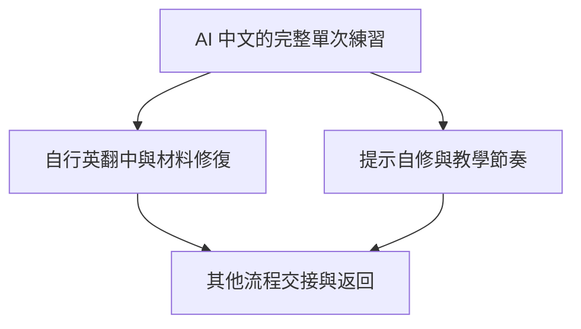

# 回譯練習 skill：實作票拆分提案

Status: closed
Date: 2026-10-15

依據：[實作規格 v1.0](spec.md)。本文件是拆分索引；使用者以 implement-spec 授權依四張拆分執行，四份獨立票已正式發布，沒有修改來源規格或先前已結案的 wayfinder 決策票。

## 建議拆分

| 順序與票名 | 真正的前置條件 | 可獨立試用的交付 |
| --- | --- | --- |
| [AI 提供中文的完整單次回譯練習](issues/01-ai-chinese-session.md) | 無 | 明確選擇 AI 中文後，完整經過回譯、B 回饋、新情境與收尾 |
| [自行英翻中與材料修復的完整練習](issues/02-learner-translation-and-material-repair.md) | AI 提供中文的完整單次回譯練習 | 自己翻中文或遇到材料問題時，仍能公平完成完整練習 |
| [提示自修與可調整的教學節奏](issues/03-self-repair-and-adaptive-feedback.md) | AI 提供中文的完整單次回譯練習 | 提示、直接示範、A／B／C 與活動調整，都能回到完整循環 |
| [在其他流程中插入回譯並接回原任務](issues/04-contextual-workflow-handoff.md) | 自行英翻中與材料修復的完整練習；提示自修與可調整的教學節奏 | 沿用不同進度、修復交接材料，練完返回原任務，交付完整首版 |

每張包含必要指令、相關資源、結構檢查與新材料的對話行為評估，不把文件層與測試層拆成獨立工作。專案目前只有設計與研究文件，沒有需要先做的程式重構。

## 依賴圖

第二與第三張在行為上互不阻擋，可以任一順序完成；這不代表必須同時修改同一份指令。第四張需兩者具備，才能完整檢查材料與不同教學進度的交接。

## 規格覆蓋

- 第一張：1、2、8、10–14、18–24、27、28、31、34–40、43–46。
- 第二張：4–10、25、26，加上其路徑下的既有循環。
- 第三張：15–17、27–33、37–39，加上其路徑下的既有循環。
- 第四張：3、41–46，並在整合成品上確認全部故事覆蓋。

第一張先形成完整可試用路徑，第二與第三張擴充真實使用情境，第四張完成兩種入口的整合交付。沒有把第四張作為所有前置票首次驗證的地方。

## 拆分確認與發布

2026-10-15：使用者呼叫 implement-spec，授權依此四張拆分執行；已發布為本機追蹤器的一票一檔，初始狀態 ready-for-agent。各票的執行與結案狀態記錄於正式票，現無待確認的拆分或依賴問題。來源規格與 wayfinder 決策票未因發布而修改。

## 完成紀錄

四張實作票均已完成並合併至 `integration/back-translation-skill`，父規格已結案。實際驗收與雙軸審查見 [整合紀錄](../../evaluations/integration-review.md)。
